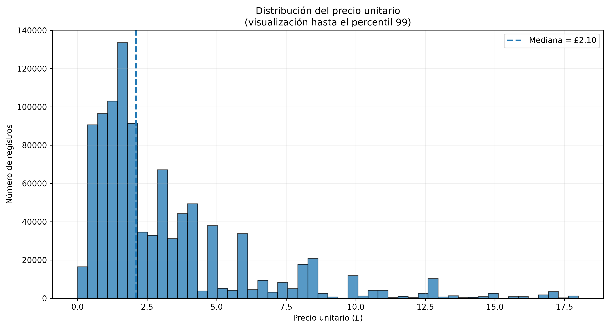
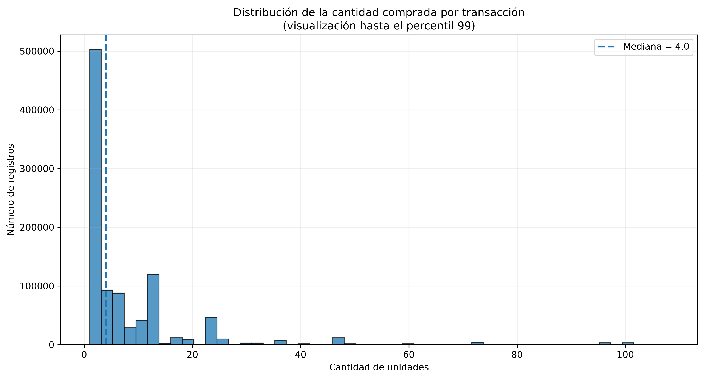
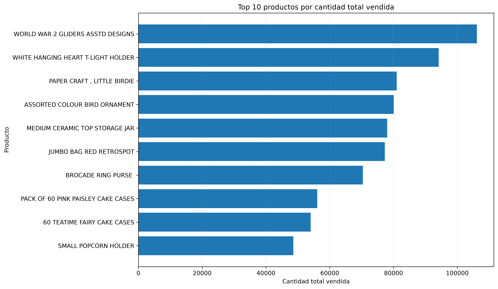
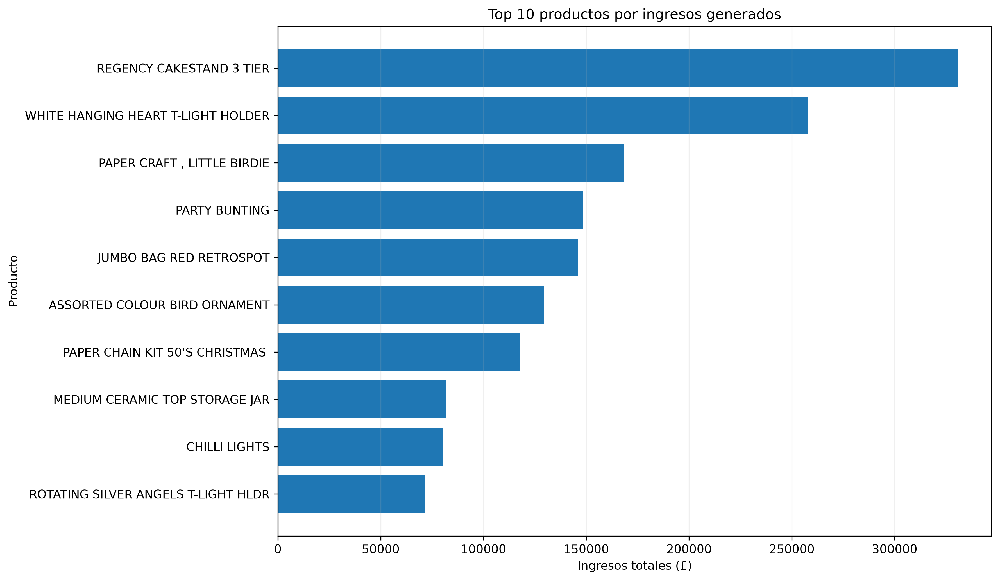
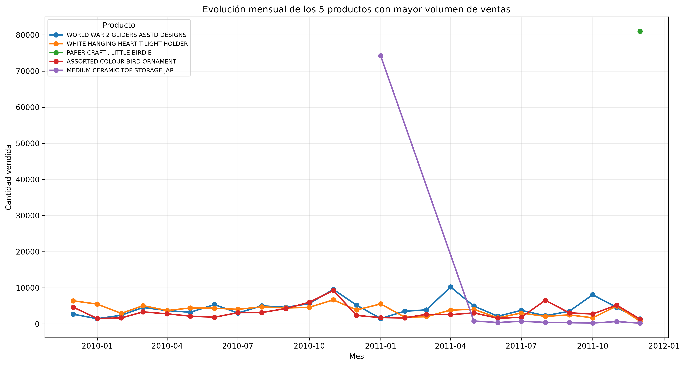
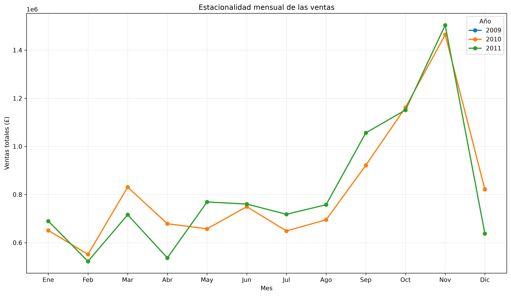
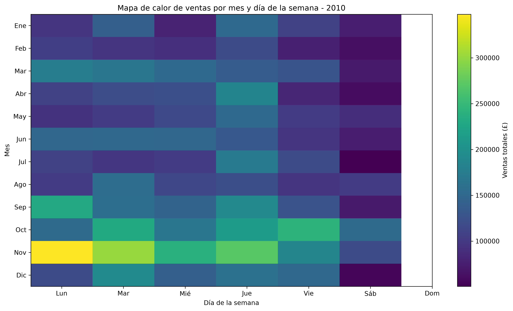

# Taller 02 - Online Retail II

## Descripción del proyecto

Este proyecto analiza el conjunto de datos **Online Retail II**, que contiene transacciones de una empresa de comercio minorista entre diciembre de 2009 y diciembre de 2011.

El trabajo se desarrolló en cuatro etapas principales:

1. Limpieza y análisis exploratorio de datos.
2. Clasificación de clientes en clientes normales y clientes Premium.
3. Segmentación de clientes mediante K-Means y Mean Shift.
4. Predicción de ventas futuras mediante Random Forest.

El objetivo general fue transformar la información transaccional en conocimiento útil para comprender el comportamiento de los clientes y apoyar posibles decisiones comerciales.

---

## Estructura del proyecto

```text
Taller_02_Online_Retail_II/
│
├── data/
│   ├── online_retail_II.xlsx
│   └── online_retail_II_limpio.csv
│
├── graficos/
│   ├── grafico_distribucion_price.png
│   ├── grafico_distribucion_quantity.png
│   ├── grafico_estacionalidad_mensual.png
│   ├── grafico_heatmap_estacionalidad_2010.png
│   ├── grafico_tendencia_top5_productos.png
│   ├── grafico_top_productos_cantidad.png
│   └── grafico_top_productos_ingresos.png
│
├── 01_limpieza_eda.py
├── 02_modelado_online_retail_II.ipynb
├── .gitignore
└── README.md

```

# 1. Limpieza y análisis exploratorio de datos

La primera etapa del proyecto correspondió a la preparación, limpieza y análisis exploratorio del conjunto de datos Online Retail II.

El objetivo de esta etapa fue comprender la estructura de los datos, identificar posibles problemas de calidad y analizar el comportamiento general de las ventas antes de aplicar algoritmos de aprendizaje automático.

---

## 1.1 Carga y exploración inicial de los datos

El conjunto de datos original se encuentra en:

`data/online_retail_II.xlsx`

La información fue cargada utilizando la biblioteca **Pandas**.

Durante la exploración inicial se revisaron aspectos como:

- número de registros,
- número de columnas,
- nombres de las variables,
- tipos de datos,
- presencia de valores faltantes,
- estructura general de las transacciones.

Entre las principales variables del conjunto de datos se encuentran:

- Invoice
- StockCode
- Description
- Quantity
- InvoiceDate
- Price
- Customer ID
- Country

Cada fila representa una línea de una transacción de compra.

---

## 1.2 Limpieza de datos

Antes del análisis se realizó un proceso de limpieza para evitar que registros incorrectos o incompletos afectaran los resultados.

Se revisaron y trataron aspectos como:

- valores faltantes,
- registros duplicados,
- transacciones sin identificación de cliente,
- pedidos cancelados,
- cantidades problemáticas,
- precios problemáticos,
- registros considerados irrelevantes para el análisis.

La limpieza fue necesaria porque los modelos de aprendizaje automático dependen directamente de la calidad de los datos utilizados.

---

## 1.3 Creación de la variable TotalAmount

Se creó una nueva variable denominada:

`TotalAmount`

Esta variable representa el valor monetario de cada línea de transacción.

Se calculó mediante:

`TotalAmount = Quantity × Price`

Esta variable permitió posteriormente analizar los ingresos generados por productos, clientes y fechas.

Después de la limpieza se generó el archivo:

`data/online_retail_II_limpio.csv`

Este archivo fue utilizado como base para las etapas posteriores de clasificación, segmentación y predicción.

---

## 1.4 Distribución del precio



Se analizó la distribución de la variable `Price`.

El análisis mostró que la mayoría de los productos presentan precios relativamente bajos, mientras que existe una menor cantidad de observaciones con precios considerablemente más altos.

Para mejorar la visualización se limitó el gráfico hasta aproximadamente el percentil 99.

Esto permitió evitar que unos pocos valores extremos comprimieran visualmente la mayor parte de los datos.

---

## 1.5 Distribución de cantidades



También se analizó la distribución de la variable `Quantity`.

La mayor parte de las transacciones corresponde a cantidades relativamente pequeñas.

Sin embargo, existen operaciones con cantidades extremadamente elevadas.

Este resultado es importante porque una gran cantidad total vendida de un producto no necesariamente significa que el producto haya sido comprado por muchos clientes.

En algunos casos, una sola transacción de gran tamaño puede representar una parte importante del volumen total.

---

## 1.6 Productos con mayor cantidad vendida



Se agruparon las transacciones por producto y se sumaron las cantidades vendidas.

Esto permitió identificar los productos con mayor volumen total de unidades.

Durante este análisis se observó que algunos productos presentaban valores extraordinariamente altos debido a pedidos individuales de gran tamaño.

Por esta razón, los resultados se interpretaron considerando no solo la cantidad total, sino también la concentración de las compras.

---

## 1.7 Productos con mayores ingresos



También se agruparon las transacciones por producto utilizando `TotalAmount`.

Esto permitió identificar los productos que generaron mayores ingresos.

Este análisis es diferente al análisis por cantidad.

Un producto puede vender muchas unidades y no necesariamente ser el producto que genera mayores ingresos.

Por esta razón se analizaron ambas perspectivas:

- volumen de unidades,
- ingresos generados.

---

## 1.8 Tendencia temporal de los productos principales



Se analizó la evolución temporal de los productos con mayor participación.

El objetivo fue observar cómo cambiaban sus ventas a lo largo del tiempo.

Este análisis permite identificar:

- aumentos o disminuciones,
- posibles patrones repetitivos,
- períodos de mayor actividad,
- comportamiento temporal de los productos más relevantes.

---

## 1.9 Estacionalidad mensual



Las ventas también fueron agrupadas por mes para analizar posibles patrones estacionales.

Los resultados mostraron un aumento importante de la actividad hacia los últimos meses del año.

Se observó especialmente un incremento alrededor de noviembre.

Este comportamiento sugiere la existencia de una componente estacional en las ventas.

La interpretación debe realizarse considerando que el período de análisis comprende datos entre diciembre de 2009 y diciembre de 2011.

---

## 1.10 Heatmap de estacionalidad



También se construyó un mapa de calor para analizar la relación entre:

- mes,
- día de la semana,
- volumen de ventas.

Los colores más intensos representan períodos con mayor nivel de ventas.

Este gráfico permite identificar de manera visual qué combinaciones de mes y día de la semana presentaron una mayor actividad comercial.

---

## 1.11 Conclusiones del análisis exploratorio

El análisis exploratorio permitió identificar varios aspectos importantes:

- la mayoría de los precios y cantidades se concentran en valores relativamente bajos;
- existen transacciones de tamaño extraordinariamente alto;
- cantidad vendida e ingresos no representan exactamente el mismo comportamiento;
- algunos productos presentan volúmenes altos concentrados en pocas operaciones;
- existe variación temporal importante en las ventas;
- los últimos meses del año presentan una mayor actividad;
- los patrones temporales deben ser considerados en las siguientes etapas del modelado.

Esta etapa permitió comprender mejor la estructura y el comportamiento de los datos antes de aplicar los modelos de aprendizaje automático.

# 2. Clasificación de clientes

La primera parte del modelado consistió en clasificar a los clientes en dos categorías:

- Cliente Normal
- Cliente Premium

La base original no contenía estas categorías, por lo que fue necesario construirlas.

---

## Variables utilizadas por cliente

La información transaccional se resumió a nivel de cliente utilizando variables como:

- Recencia
- Frecuencia
- Cantidad total
- Gasto total

### Recencia

Representa el número de días transcurridos desde la última compra del cliente.

Una recencia baja indica que el cliente compró recientemente.

### Frecuencia

Representa el número de compras realizadas por el cliente.

### Cantidad total

Representa el total de unidades adquiridas por el cliente.

### Gasto total

Representa el monto total gastado por el cliente durante el período analizado.

---

## Definición de clientes Premium

Se utilizó el gasto total como criterio principal.

El umbral Premium fue aproximadamente:

**£2.910,08**

Este valor corresponde aproximadamente al percentil 80 del gasto total.

Esto permitió clasificar a los clientes de la siguiente manera:

- Clientes totales: 5.878
- Clientes normales: 4.702
- Clientes Premium: 1.176

Aproximadamente el 20% de los clientes fueron considerados Premium.

---

## Perfil de clientes normales y Premium

| Variable | Normal | Premium |
|---|---:|---:|
| Recencia media | 235,38 días | 65,19 días |
| Frecuencia media | 3,19 | 18,66 |
| Cantidad media | 511,51 | 6.895,28 |
| Gasto medio | £840,71 | £11.413,07 |

Los clientes Premium presentan menor recencia, mayor frecuencia, mayor cantidad comprada y mayor gasto.

---

## Modelo de clasificación

Se utilizó un modelo de **Random Forest Classifier**.

Las variables predictoras principales fueron:

- Recencia
- Frecuencia
- Cantidad total

La variable objetivo fue:

**Normal / Premium**

---

## Resultados de clasificación

El modelo obtuvo:

**Accuracy: 0.9354**

Esto significa que aproximadamente el 93,54% de los clientes del conjunto de prueba fueron correctamente clasificados.

### Resultados para clientes normales

- Precision: 0.96
- Recall: 0.96
- F1-score: 0.96

### Resultados para clientes Premium

- Precision: 0.84
- Recall: 0.84
- F1-score: 0.84

---

## Matriz de confusión

La matriz de confusión obtenida fue:

```text

[[902, 39],
 [ 37,198]]

```

Interpretación:
- 902 clientes normales fueron correctamente clasificados.
- 198 clientes Premium fueron correctamente clasificados.
- 39 clientes normales fueron clasificados como Premium.
- 37 clientes Premium fueron clasificados como normales.

Importancia de variables
La importancia aproximada de las variables fue:
Cantidad_total    0.546
Frecuencia        0.309
Recencia          0.145
La variable con mayor importancia predictiva fue la cantidad total comprada.

# 3. Segmentación de clientes

La segunda parte del modelado correspondió a un problema de aprendizaje no supervisado.

A diferencia de la clasificación, en esta etapa no se definieron previamente las categorías de clientes.

El objetivo fue identificar grupos de clientes con comportamientos similares a partir de sus características de compra.

Para esta etapa se utilizaron dos algoritmos:

- K-Means
- Mean Shift

---

# 3.1 Segmentación con K-Means

K-Means es un algoritmo de agrupamiento que divide las observaciones en un número determinado de grupos o clusters.

Para este análisis se utilizaron principalmente variables relacionadas con el comportamiento de compra de los clientes, como:

- Recencia
- Frecuencia
- Gasto total

---

## Escalamiento de variables

Antes de aplicar K-Means se utilizó:

**StandardScaler**

El escalamiento fue necesario porque las variables tenían magnitudes diferentes.

Por ejemplo, el gasto total podía tener valores mucho mayores que la frecuencia o la recencia.

Si las variables no se escalan, aquellas con valores numéricos más grandes pueden tener mayor influencia en el cálculo de las distancias.

---

## Primera prueba de K-Means

En una primera prueba se observó una segmentación muy desbalanceada.

Se obtuvieron aproximadamente:

- Cluster 0: 18 clientes
- Cluster 1: 5.860 clientes

Aunque en esta prueba el Silhouette Score fue muy alto, aproximadamente:

**0.9236**

el resultado estaba fuertemente influenciado por clientes con valores extremos.

Por esta razón, una métrica alta no se interpretó automáticamente como una buena segmentación comercial.

---

## Transformación logarítmica

Para disminuir el efecto de los valores extremos se aplicó una transformación logarítmica a las variables antes del escalamiento definitivo.

La transformación logarítmica permitió reducir las grandes diferencias existentes entre clientes con comportamientos normales y clientes con valores extremadamente altos.

Esta transformación no elimina clientes, sino que modifica la escala de las variables para facilitar una agrupación más equilibrada.

---

## Evaluación del número de clusters

Se probaron diferentes valores de `k`, donde `k` representa el número de clusters.

También se evaluó el Silhouette Score.

Los resultados obtenidos fueron aproximadamente:

| Número de clusters (k) | Silhouette Score |
|---|---:|
| 2 | 0.4386 |
| 3 | 0.3477 |
| 4 | 0.3650 |
| 5 | 0.3425 |
| 6 | 0.3348 |

Aunque `k = 2` presentó el valor más alto de Silhouette, se decidió trabajar con cuatro clusters.

Esta decisión se tomó porque cuatro grupos permitían obtener una segmentación comercial más detallada e interpretable.

Por lo tanto, la selección no se basó únicamente en la métrica Silhouette, sino también en la utilidad de los segmentos obtenidos.

---

## Resultado final de K-Means

El modelo final se ejecutó con:

**K-Means con 4 clusters**

La distribución obtenida fue:

- Cluster 0: 1.973 clientes
- Cluster 1: 1.250 clientes
- Cluster 2: 1.196 clientes
- Cluster 3: 1.459 clientes

---

## Perfil de los clusters de K-Means

| Cluster | Clientes | Recencia media | Frecuencia media | Cantidad media | Gasto medio |
|---|---:|---:|---:|---:|---:|
| 0 | 1.973 | 394,95 | 1,38 | 187,60 | £317,08 |
| 1 | 1.250 | 28,30 | 3,05 | 530,97 | £857,49 |
| 2 | 1.196 | 27,71 | 19,28 | 6.336,26 | £10.731,16 |
| 3 | 1.459 | 230,07 | 5,06 | 1.303,59 | £1.948,50 |

Estos resultados permitieron identificar diferentes tipos de comportamiento entre los clientes.

---

## Interpretación comercial de los segmentos

A partir de las características de los clusters se definieron perfiles comerciales.

### Inactivos - Bajo valor

Son clientes con:

- recencia alta,
- frecuencia baja,
- cantidad comprada baja,
- gasto bajo.

Representan clientes que llevan bastante tiempo sin comprar y cuyo valor económico actual es reducido.

---

### Recientes ocasionales

Son clientes con:

- recencia baja,
- frecuencia relativamente baja,
- cantidad y gasto moderados.

Estos clientes han comprado recientemente, pero todavía no presentan una frecuencia elevada.

Pueden representar una oportunidad para desarrollar una relación comercial más frecuente.

---

### Alto valor

Son clientes con:

- recencia baja,
- frecuencia alta,
- cantidad comprada alta,
- gasto elevado.

Representan uno de los grupos de mayor interés comercial, ya que compran frecuentemente, han comprado recientemente y presentan un gasto significativamente superior.

---

### Intermedios - En riesgo

Son clientes con:

- un historial de compras mayor que los clientes de bajo valor,
- frecuencia intermedia,
- gasto intermedio,
- recencia relativamente elevada.

Esto indica que anteriormente tuvieron actividad comercial, pero actualmente llevan más tiempo sin comprar.

Por esta razón pueden considerarse clientes con riesgo de alejamiento.

---

# 3.2 Segmentación con Mean Shift

También se utilizó el algoritmo Mean Shift.

A diferencia de K-Means, Mean Shift no necesita que se indique previamente el número exacto de clusters.

El algoritmo identifica automáticamente zonas de mayor densidad dentro de los datos.

---

## Bandwidth

Para Mean Shift se estimó automáticamente el parámetro denominado:

**Bandwidth**

El valor obtenido fue aproximadamente:

**1.2334**

El bandwidth determina la amplitud utilizada por el algoritmo para buscar concentraciones de observaciones.

Un bandwidth muy pequeño puede generar muchos grupos, mientras que uno muy grande puede unir grupos diferentes.

---

## Resultado de Mean Shift

Mean Shift identificó automáticamente:

**3 clusters**

La distribución fue:

- Cluster 0: 5.269 clientes
- Cluster 1: 263 clientes
- Cluster 2: 346 clientes

---

## Perfil de los clusters de Mean Shift

| Cluster | Recencia media | Frecuencia media | Cantidad media | Gasto medio |
|---|---:|---:|---:|---:|
| 0 | 221,78 | 3,85 | 805,33 | £1.260,53 |
| 1 | 44,95 | 42,50 | 16.633,10 | £28.329,15 |
| 2 | 8,86 | 15,99 | 5.480,21 | £9.487,00 |

El algoritmo identificó un grupo muy grande de clientes con comportamiento más general y dos grupos más pequeños con comportamientos de compra significativamente superiores.

---

# 3.3 Comparación entre K-Means y Mean Shift

Los resultados finales fueron:

| Algoritmo | Número de clusters | Silhouette Score |
|---|---:|---:|
| K-Means | 4 | 0.3650 |
| Mean Shift | 3 | 0.3519 |

K-Means presentó un Silhouette Score ligeramente superior.

Además, los cuatro grupos obtenidos mediante K-Means permitieron realizar una interpretación comercial más detallada de los diferentes tipos de clientes.

Mean Shift tuvo como ventaja que determinó automáticamente el número de clusters sin necesidad de establecer previamente un valor de `k`.

Para este análisis, K-Means resultó más útil desde el punto de vista de interpretación comercial, mientras que Mean Shift permitió comprobar la existencia de agrupaciones naturales utilizando un enfoque diferente.

# 4. Predicción de ventas

La tercera parte del proyecto consistió en desarrollar un modelo para estimar ventas futuras a partir del comportamiento histórico de las ventas.

En esta etapa se trabajó con un problema de regresión, ya que la variable objetivo es numérica.

El algoritmo utilizado fue:

**Random Forest Regressor**

---

## 4.1 Construcción de ventas diarias

Las transacciones fueron agrupadas por fecha para obtener el total de ventas de cada día.

El período analizado fue:

**01/12/2009 hasta 09/12/2011**

Inicialmente se identificaron:

**604 días con ventas registradas**

---

## 4.2 División temporal de los datos

Para la predicción de ventas no se utilizó una división aleatoria.

Se respetó el orden cronológico de la información.

Esto significa que:

- los datos más antiguos se utilizaron para entrenamiento;
- los datos más recientes se utilizaron para prueba.

Este procedimiento evita utilizar información del futuro para predecir el pasado.

---

## 4.3 Creación de características temporales

Para mejorar la capacidad predictiva del modelo se crearon nuevas variables a partir de la fecha y del historial de ventas.

Entre las variables utilizadas se encuentran:

- Mes
- Día de la semana
- Fin de semana
- Semana del año
- Día del mes
- Año
- Trimestre
- Lag_1
- Lag_7
- Lag_14
- Lag_28
- Media_7
- Media_28
- Std_7

La creación de estas variables se conoce como **feature engineering**.

---

## 4.4 Variables Lag

Las variables Lag representan valores históricos de las ventas.

Por ejemplo:

- `Lag_1`: ventas del día anterior.
- `Lag_7`: ventas de siete días antes.
- `Lag_14`: ventas de catorce días antes.
- `Lag_28`: ventas de veintiocho días antes.

Estas variables permiten que el modelo utilice el comportamiento reciente de las ventas para realizar nuevas estimaciones.

---

## 4.5 Medias móviles

También se utilizaron medias móviles.

Por ejemplo:

- `Media_7`: promedio de las ventas recientes de una ventana de siete días.
- `Media_28`: promedio de las ventas recientes de una ventana de veintiocho días.

Estas variables ayudan a representar tendencias recientes y suavizar fluctuaciones diarias.

---

## 4.6 Primer modelo de predicción

En la primera versión del modelo se utilizaron:

- 477 días para entrenamiento.
- 120 días para prueba.

Los resultados fueron:

- MAE: £12.742,03
- RMSE: £20.519,14
- R²: 0.3377

Este primer modelo mostró capacidad predictiva, pero todavía existía margen de mejora.

---

## 4.7 Mejora de la serie temporal

Durante el análisis se observó que la serie inicial contenía únicamente los días en los que existían ventas registradas.

Esto generaba un problema para las variables temporales.

Por ejemplo, `Lag_1` debía representar exactamente el día anterior y no simplemente el registro anterior disponible.

Por esta razón se construyó una serie diaria continua.

El período completo contenía:

**739 días calendario**

Se identificaron:

**135 días sin ventas registradas**

Estos días fueron incorporados en la serie con:

`TotalAmount = 0`

Esto permitió mantener la continuidad temporal del conjunto de datos.

---

## 4.8 Modelo mejorado

Después de construir la serie diaria continua y generar las nuevas características temporales quedaron:

**711 registros disponibles para modelado**

La división temporal final fue:

- Entrenamiento: 568 días.
- Prueba: 143 días.

Período de entrenamiento:

**29/12/2009 hasta 19/07/2011**

Período de prueba:

**20/07/2011 hasta 09/12/2011**

---

## 4.9 Resultados del modelo mejorado

El modelo Random Forest mejorado obtuvo:

- MAE: £10.809,01
- RMSE: £18.934,37
- R²: 0.5409

Comparación entre el primer modelo y el modelo mejorado:

| Métrica | Primer modelo | Modelo mejorado |
|---|---:|---:|
| MAE | £12.742,03 | £10.809,01 |
| RMSE | £20.519,14 | £18.934,37 |
| R² | 0.3377 | 0.5409 |

Los resultados muestran una mejora en las tres métricas.

El MAE y el RMSE disminuyeron, mientras que el R² aumentó.

---

## 4.10 Interpretación de las métricas

### MAE

El MAE representa el error absoluto promedio de las predicciones.

En el modelo mejorado:

**MAE = £10.809,01**

Esto significa que, en promedio, las predicciones se alejaron aproximadamente £10.809 de las ventas reales diarias.

### RMSE

El RMSE también mide el error de predicción, pero penaliza con mayor intensidad los errores grandes.

El modelo obtuvo:

**RMSE = £18.934,37**

El hecho de que el RMSE sea mayor que el MAE indica que existen algunos días con errores de predicción considerablemente altos.

### R²

El modelo obtuvo:

**R² = 0.5409**

Esto significa que el modelo explica aproximadamente el 54% de la variabilidad observada en las ventas diarias.

R² no representa un porcentaje de exactitud.

---

## 4.11 Comparación con modelos base

Para comprobar si Random Forest realmente mejoraba la predicción, se comparó con dos modelos simples de referencia.

### Base Lag 1

Este modelo utiliza las ventas del día anterior como predicción.

Resultados:

- MAE: £22.731,46
- RMSE: £29.781,78
- R²: -0.14

### Base Lag 7

Este modelo utiliza las ventas de siete días antes como predicción.

Resultados:

- MAE: £13.169,22
- RMSE: £21.395,86
- R²: 0.41

### Comparación

| Modelo | MAE | RMSE | R² |
|---|---:|---:|---:|
| Random Forest mejorado | £10.809,01 | £18.934,37 | 0.54 |
| Base Lag 1 | £22.731,46 | £29.781,78 | -0.14 |
| Base Lag 7 | £13.169,22 | £21.395,86 | 0.41 |

Random Forest obtuvo mejores resultados que los dos modelos base.

---

## 4.12 Importancia de variables

Las variables con mayor importancia aproximada dentro del modelo fueron:

```text
Media_7         0.2238
Lag_7           0.1699
Fin_semana      0.1556
Dia_semana      0.1325
Lag_1           0.0818
Lag_28          0.0521
Media_28        0.0388
Std_7           0.0351
Semana_anio     0.0344
Lag_14          0.0344
Dia_mes         0.0284
Mes             0.0072
Anio            0.0045
Trimestre       0.0013
La variable más importante fue Media_7, seguida de Lag_7.
Esto indica que el comportamiento reciente de las ventas y los patrones semanales fueron especialmente relevantes para la predicción.

4.13 Interpretación del modelo
El modelo logró seguir parte importante de los patrones generales de las ventas.
Sin embargo, presentó mayor dificultad para anticipar algunos picos extraordinarios.
Esto explica por qué el modelo mejora considerablemente frente a los modelos base, pero no alcanza un R² cercano a 1.
En conclusión, el modelo captura una parte importante del comportamiento temporal de las ventas, aunque todavía existen eventos extremos difíciles de predecir.

# 5. Conclusiones

A partir del desarrollo del proyecto se obtuvieron las siguientes conclusiones:

1. La limpieza y preparación de los datos fue fundamental antes de aplicar cualquier algoritmo de aprendizaje automático.

2. El análisis exploratorio permitió identificar distribuciones sesgadas, valores extremos, diferencias entre volumen vendido e ingresos, y patrones temporales en las ventas.

3. La clasificación de clientes mediante Random Forest permitió diferenciar clientes normales y Premium con una accuracy aproximada de 93,54%.

4. Los clientes Premium presentaron, en promedio, menor recencia, mayor frecuencia de compra, mayor cantidad adquirida y mayor gasto acumulado.

5. La segmentación con K-Means permitió obtener cuatro perfiles comerciales interpretables.

6. La segmentación con Mean Shift identificó automáticamente tres grupos de clientes.

7. K-Means obtuvo un Silhouette Score ligeramente superior al de Mean Shift y permitió una interpretación comercial más detallada.

8. La transformación logarítmica fue importante para disminuir el efecto de clientes con valores extremos en la segmentación.

9. En la predicción de ventas, la construcción de una serie diaria continua mejoró el significado de las variables temporales.

10. La incorporación de variables como Lag_1, Lag_7, Lag_14, Lag_28, Media_7 y Media_28 permitió mejorar el desempeño del modelo.

11. El modelo Random Forest mejorado obtuvo un R² aproximado de 0.54 y superó a los modelos base basados en Lag 1 y Lag 7.

12. Las variables relacionadas con el comportamiento reciente y semanal de las ventas fueron las más importantes dentro del modelo predictivo.

13. Aunque el modelo logró capturar parte importante de los patrones temporales, todavía presentó dificultad para anticipar algunos picos extraordinarios de ventas.

---

# 6. Tecnologías utilizadas

El proyecto fue desarrollado utilizando las siguientes herramientas y bibliotecas:

- Python
- Pandas
- NumPy
- Matplotlib
- Scikit-learn
- Jupyter Notebook
- Visual Studio Code
- Google Colab
- Git
- GitHub

---

# 7. Organización del trabajo

## Archivo `01_limpieza_eda.py`

Contiene principalmente:

- carga de datos;
- exploración inicial;
- limpieza de datos;
- creación de la variable `TotalAmount`;
- análisis de distribuciones;
- análisis de productos;
- análisis temporal;
- análisis de estacionalidad;
- generación de gráficos.

---

## Archivo `02_modelado_online_retail_II.ipynb`

Contiene las etapas de aprendizaje automático:

- preparación de información a nivel de cliente;
- clasificación de clientes normales y Premium;
- Random Forest Classifier;
- evaluación mediante accuracy, precision, recall y F1-score;
- matriz de confusión;
- segmentación mediante K-Means;
- transformación logarítmica;
- StandardScaler;
- evaluación mediante Silhouette Score;
- segmentación mediante Mean Shift;
- comparación entre K-Means y Mean Shift;
- construcción de ventas diarias;
- creación de variables temporales;
- Random Forest Regressor;
- comparación con modelos base;
- evaluación mediante MAE, RMSE y R².

---

# 8. Flujo general del proyecto

El flujo seguido en el proyecto fue:

`online_retail_II.xlsx`

↓

`01_limpieza_eda.py`

↓

`online_retail_II_limpio.csv`

↓

`02_modelado_online_retail_II.ipynb`

↓

Clasificación, segmentación y predicción de ventas

Este flujo permite mantener una separación clara entre la preparación inicial de los datos y las etapas posteriores de aprendizaje automático.

---

# 9. Reproducibilidad y control de versiones

El proyecto fue organizado utilizando Git y GitHub.

El archivo `.gitignore` permite excluir archivos locales que no deben almacenarse en el repositorio.

Entre ellos:

```text
.venv/
__pycache__/
.ipynb_checkpoints/
*.pyc

El entorno virtual .venv se mantiene únicamente de forma local.
Esto evita subir a GitHub archivos innecesarios o específicos del computador utilizado para desarrollar el proyecto.

10. Datos del proyecto
El repositorio conserva:
- el archivo original online_retail_II.xlsx;
- el archivo procesado online_retail_II_limpio.csv;
- el script de limpieza y análisis exploratorio;
- el notebook de modelado;
- los gráficos generados;
- la documentación del proyecto.
Esto permite mantener trazabilidad entre los datos originales, los datos procesados y los resultados obtenidos.

